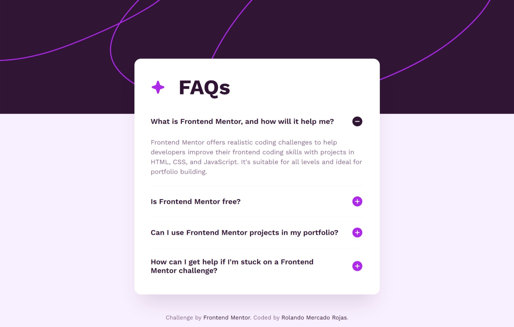
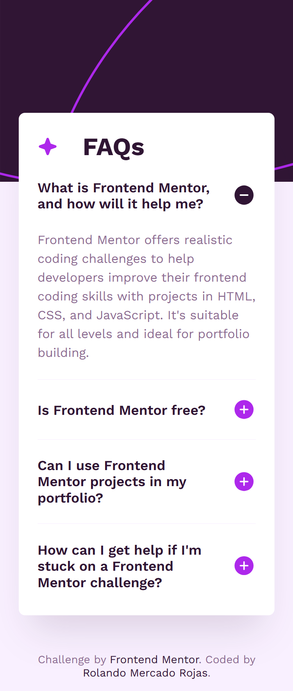

# Frontend Mentor - FAQ accordion solution

This is a solution to the [FAQ accordion challenge on Frontend Mentor](https://www.frontendmentor.io/challenges/faq-accordion-wyfFdeBwBz). Frontend Mentor challenges help you improve your coding skills by building realistic projects. 

## Table of contents

- [Overview](#overview)
  - [The challenge](#the-challenge)
  - [Screenshot](#screenshot)
  - [Links](#links)
- [My process](#my-process)
  - [Built with](#built-with)
  - [What I learned](#what-i-learned)
  - [Continued development](#continued-development)
- [Author](#author)

## Overview

### The challenge

Users should be able to:

- Hide/Show the answer to a question when the question is clicked
- Navigate the questions and hide/show answers using keyboard navigation alone
- View the optimal layout for the interface depending on their device's screen size
- See hover and focus states for all interactive elements on the page

### Screenshot

#### Desktop

#### Mobile

### Links

- Solution URL: [GitHub Repository](https://github.com/rolando2012/fm-FAQ-accordion)
- Live Site URL: [Live Demo](https://rolando2012.github.io/fm-FAQ-accordion/)

## My process

### Built with

- Semantic HTML5 markup
- CSS custom properties & logical properties (`margin-block`, `padding-inline`, `border-block-end`)
- BEM (Block, Element, Modifier) naming convention
- Flexbox & CSS Grid (smooth height transitions via `grid-template-rows`)
- Mobile-first workflow
- Vanilla JavaScript (DOM manipulation & event handling)
- Web Accessibility (WAI-ARIA accordion pattern, `aria-expanded`, `aria-controls`, `:focus-visible`, and keyboard navigation with `ArrowUp`/`ArrowDown`/`Home`/`End`)

### What I learned

Building this project helped me solidify core frontend fundamentals before moving on to component-based frameworks like React:

- **WAI-ARIA Accordion Pattern & Keyboard Accessibility:** Instead of relying solely on click events, I structured each question as a `<button>` nested inside an `<h2>` heading to preserve document hierarchy. I synchronized `aria-expanded` and `aria-hidden` states via JavaScript and implemented full keyboard navigation (`ArrowUp`, `ArrowDown`, `Home`, and `End`) following WAI-ARIA authoring practices.
- **Smooth Height Transitions in Pure CSS:** I animated the accordion panels without hardcoding `max-height` values by transitioning `grid-template-rows` from `0fr` to `1fr`, while respecting user motion preferences with `@media (prefers-reduced-motion: reduce)`.
- **Modern CSS & Logical Properties:** I replaced physical directional properties with CSS logical properties (`margin-block`, `padding-inline`, `border-block-end`) and paired them with the BEM methodology to keep specificity flat and maintainable.

### Continued development

In my next vanilla project—the **Mortgage Repayment Calculator** challenge—I plan to scale up my JavaScript and CSS skills by focusing on:

- **Complex Form State & Multi-Field Validation:** Managing multiple user inputs (currency amounts, interest rates, loan terms, and custom radio buttons), handling simultaneous error states with `aria-invalid`, and formatting financial outputs with `Intl.NumberFormat`.
- **Advanced Form Styling:** Practicing `:focus-within` states for input groups with prefix/suffix badges and building asymmetric responsive layouts.

Once I complete that challenge, I will transition to building interactive web applications using **React** and **Tailwind CSS** for my remote frontend portfolio.

## Author

- Frontend Mentor - [@rolando2012](https://www.frontendmentor.io/profile/rolando2012)
- Github - [@rolando2012](https://github.com/rolando2012)
- LinkedIn - [Rolando Mercado Rojas
](https://www.linkedin.com/in/rolando-mercado-rojas/)
